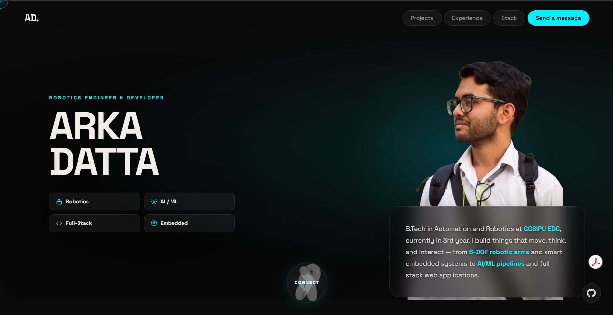

# Arka Datta — Portfolio

Personal portfolio site for **Arka Datta**, Robotics Systems Engineer & Full-Stack Developer.
A brutalist, HUD-inspired portfolio engineered with vanilla HTML, modern CSS, procedural Web Audio, Three.js WebGL rendering, and modular ES6+ JavaScript.

🔗 **Live Site:** [https://arka-124.github.io/Portfolio/](https://arka-124.github.io/Portfolio/)

---

## Preview



---

## Key Features

- **Command Palette HUD v3.0 (`⌘K` / `Ctrl+K`)**: Keyboard-driven quick navigation, fuzzy project search, and CLI terminal utilities (`whoami`, `skills`, `status`, `sfx`, `resume`, `theme`, `copy email`).
- **Tactical HUD Theme Engine**: 4 runtime color themes (**Cyber Cyan**, **Tactical Amber**, **Matrix Green**, **Pure Monochrome**) with zero-FOUC persistence in `localStorage`.
- **Procedural Web Audio 2.0 Engine**: Real-time synthesized audio feedback (frequency glides on theme switches, ascending arpeggio on clipboard copies, micro-clicks) without external MP3/WAV dependencies.
- **Official Resume & Executive Dossier Suite**: ATS-compliant single-page A4 resume ([resume.html](resume.html)), automated PDF print download ([resume.pdf](resume.pdf)), and an interactive candidate dossier modal.
- **Hero Radar & Micro-Interactions**: Proximity-reactive radar scanner, dynamic cursor click telemetry ping, interactive magnetic chips, and cybernetic text glitch scrambler.
- **Creative Stack Inspector**: Interactive hardware and web technology grid with real-time project linking and highlight pulses.
- **3D WebGL Glass Visualizers**: Lightweight Three.js liquid-glass button and fluid glass background featuring `IntersectionObserver` viewport render-pausing and `prefers-reduced-motion` support.
- **Deep-Dive Project Case Studies**: Dedicated technical breakdowns for FogBot, ZeroEgress, 4-DOF Robotic Arm, and more.
- **Full Privacy & Accessibility**: Screen-reader ARIA landmarks, `rel="noopener noreferrer"` external links, keyboard navigation, and zero network tracking.

---

## Tech Stack

- **Markup & Layout:** HTML5 (Semantic, Open Graph, Twitter Cards)
- **Styling:** Modern CSS3 (Grid & Flexbox, custom CSS properties, responsive media queries, glassmorphism)
- **Scripting & Modularity:** Vanilla ES6+ Modules (`modules/sfx.js`, `modules/themes.js`, `modules/commands.js`, `modules/resume.js`, etc.)
- **3D & Graphics:** [Three.js r160](https://threejs.org/) (via cdnjs Cloudflare CDN with viewport-optimized render loop)
- **Animations:** [GSAP 3.12.5](https://gsap.com/) + ScrollTrigger (with Subresource Integrity hashes)
- **Audio:** Web Audio API (Synthesized oscillators)
- **Typography:** Space Grotesk, Playfair Display, Inter (Google Fonts)
- **Deployment:** GitHub Pages

---

## Project Structure

```
Portfolio/
├── index.html              # Main portfolio HUD (hero, projects, experience, stack, dossier)
├── contact.html            # Dedicated contact page & credentials banner
├── resume.html             # Standalone 1-page ATS-optimized print resume
├── resume.pdf              # Pre-compiled print-ready PDF resume download
├── glass-button.js         # Shared viewport-paused Three.js glass visualizer
├── interactive.js          # Core module coordinator and global event bridge
├── modules/                # Modular client architecture
│   ├── sfx.js              # Procedural Web Audio synth & SFX controls
│   ├── toast.js            # HUD toast notification & clipboard engine
│   ├── themes.js           # Tactical HUD theme palettes & persistence
│   ├── resume.js           # Executive dossier modal & copy triggers
│   ├── commands.js         # Command palette items, fuzzy search & CLI
│   ├── projects.js         # Category filtering & 3D glare card tilt
│   ├── stack.js            # Interactive stack inspector & project pulse
│   ├── hero.js             # Radar proximity, click ping, text scrambler & IST clock
│   └── about.js            # Frosted glass spotlight & action pills
├── script.js               # Scroll-reveal, GSAP parallax, nav tint & drawer
├── cursor.js               # Dual-ring cyber cursor tracker
├── styles.css              # Main design system and brutalist layouts
├── contact.css             # Contact page styling
├── cursor.css              # Cursor styles
├── interactive.css          # HUD palette, modals, toasts & pill buttons
├── projects/               # Detailed project deep-dive pages
│   ├── project.css         # Shared brutalist layout for project detail pages
│   ├── fogbot.html         # FogBot — Autonomous Pilot Rover (with YouTube embed)
│   ├── zeroegress.html     # ZeroEgress — Air-Gapped File Utilities & OS Distributor
│   ├── robotic-arm.html    # Miniature 4-DOF Robotic Arm with potentiometer mimic
│   ├── toll-gate.html      # Automated Toll Gate Development
│   ├── movie-review-qa.html# AI Chatbot for Movie Reviews (FastAPI / NLP)
│   └── vm-automobiles.html # VM Automobiles Luxury Website
├── images/                 # Optimized WebP photos, og-image, and project media
├── logo/                   # Clean favicon.png and tech stack logos
└── docs/                   # Internal specifications and architecture notes
```

---

## Running Locally

No bundler or compiler is required — the site runs directly in any modern browser:

```bash
# Clone the repository
git clone https://github.com/Arka-124/Portfolio.git
cd Portfolio

# Optional: Run a local static server (recommended for module imports)
npx serve
# or
python -m http.server 8000
```

Navigate to `http://localhost:3000` (or `http://localhost:8000`) in your browser.

---

## Demonstrations & Media

- **FogBot Video Demonstration:** [YouTube Live Demo](https://youtu.be/Vd6CsiFEdiw)
- **ZeroEgress Live Web Application:** [Direct Distribution Portal](https://arka-124.github.io/Portfolio/projects/zeroegress.html)

---

## Contact & Coordinates

- **Email:** [arkadatta1531@gmail.com](mailto:arkadatta1531@gmail.com)
- **LinkedIn:** [/in/arka-datta-88a961381](https://www.linkedin.com/in/arka-datta-88a961381/)
- **GitHub:** [@Arka-124](https://github.com/Arka-124)
- **Instagram:** [@notagain.arkaaa](https://www.instagram.com/notagain.arkaaa)
